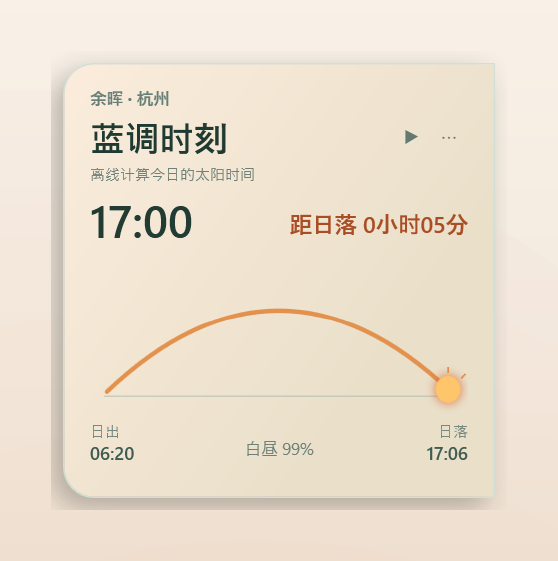
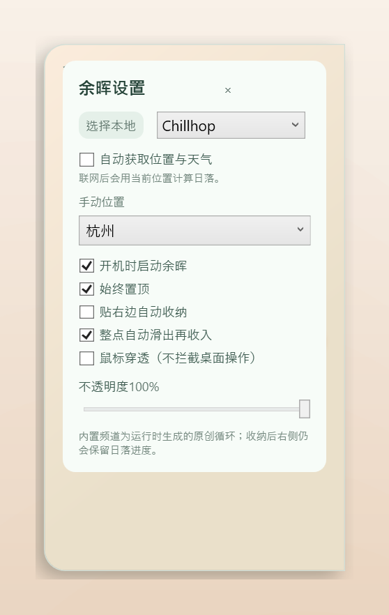
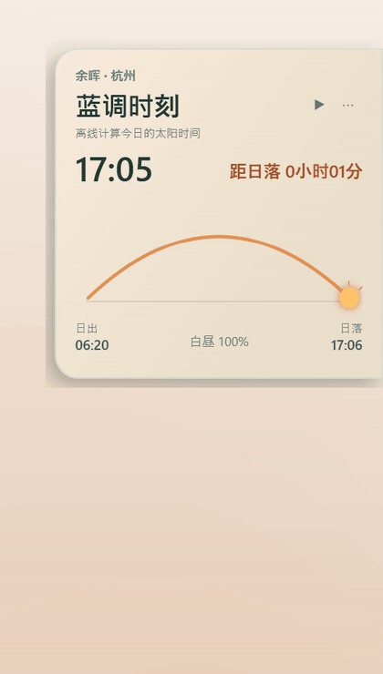

# 余晖 · Yuhui

一个常驻桌面右侧的「日落进度」小挂件。

它用一条太阳弧线把**今天还剩多少白天**直观地画在桌面上——几点日出、几点日落、现在处于清晨 / 下午 / 黄金时刻 / 蓝调时刻，以及**距日落还剩多久**，一眼就能看明白。配合随时间缓变的暖色调和一段本地生成的 Lofi 循环，你可以**按时间规律安排办公与生活作息**：清晨进入工作、午后留意效率、黄金时刻收尾、蓝调时刻收工，让时间感从数字变成一种氛围。

基于 **C# / .NET 10 / WPF** 编写，单文件窗口，无边框、半透明、可收纳，断网也能离线计算日落。

<p align="center">
  
  
</p>

## 运行演示

<p align="center">
  
</p>

## 功能特性

### 一眼看清今天还剩多少时间

- **日落进度弧线**：以日出、日落为两端画一条贝塞尔弧线，太阳标记随当前时间移动，底部显示日出、日落与白昼百分比。
- **距日落倒计时**：卡片右上角始终显示「距日落 X 小时 Y 分」，让你对今天的剩余白昼有量化感知。
- **时段文案**：按白昼进度自动切换「清晨 / 下午 / 黄金时刻 / 蓝调时刻」，配合随光缓变的渐变色，把抽象的时间变成一眼可辨的氛围。
- **实时时钟 + 日出日落时刻**：当前时间、今日日出、日落同时显示，方便按时间规律安排办公与生活节奏。

### 按时间规律安排作息

| 时段 | 建议节奏 |
| --- | --- |
| 清晨（白昼 < 18%） | 进入深度工作，处理需要专注的任务 |
| 下午（18%–64%） | 常规协作、会议、沟通 |
| 黄金时刻（64%–89%） | 收尾当日产出，回顾清单 |
| 蓝调时刻（> 89%） | 收工、放松，进入生活时间 |

开启「整点自动滑出」后，每到整点卡片会从屏幕边缘滑出一次，温柔地提醒你留意时间；开启「贴右边自动收纳」后，它平时只露出一条边，不打扰桌面，需要时鼠标靠过去即可展开。

### 环境与氛围

- **随光变色**：卡片底色随白昼进度从清透的青绿渐变到暖橘米色，越接近日落越暖。
- **内置 Lofi 电台**：9 个频道（Chillhop、Late night vibes、Hip hop radio、Relaxing beats、Coffee shop radio、Videogame lofi、Space ambient、Sad & sleepy、Lofi synthwave），音频由程序在本地实时合成 28 秒循环并缓存，无需联网；把鼠标放在 ▶ 上滚动滚轮即可切换频道，工作时放一段 Chillhop，收工前换 Space ambient。
- **本地与在线音源**：可选择本地音频文件循环播放，或跳转 lofi.cafe 在线电台。

### 定位与天气

- **自动定位与天气**：联网时通过 IP 定位获取城市，并向开放天气接口取当天日落时间与云量，天气文案会跟着变化；断网或接口异常时自动回退到 NOAA 太阳位置算法离线计算。
- **手动城市**：内置杭州、上海、北京、成都四个城市坐标，可随时切换。

### 桌面行为

- **贴边收纳**：贴住屏幕右侧，鼠标移开后自动收起。
- **鼠标穿透**：开启后窗口不拦截桌面点击（`WS_EX_TRANSPARENT`），只做视觉陪伴。
- **不透明度**：35%–100% 无级调节。
- **开机自启 / 始终置顶**：开机自启写入当前用户的 `Run` 注册表项，不做系统级修改。
- **托盘常驻**：托盘图标可显示 / 隐藏窗口、固定到屏幕边缘、切换鼠标穿透、退出。
- **记忆偏好**：所有设置保存在程序目录下的 `yuhui.settings.json`，下次启动自动恢复。

## 快速开始

### 直接运行

1. 安装 [.NET 10 Desktop Runtime](https://dotnet.microsoft.com/download/dotnet/10.0)（Windows x64）。
2. 运行 `release/win-x64/Yuhui.exe`。

仓库中的 `release/win-x64` 是一份可直接运行的框架依赖版本，省去自行编译的步骤。

### 从源码构建

需要 [.NET 10 SDK](https://dotnet.microsoft.com/download/dotnet/10.0)。

```powershell
# 调试运行
dotnet run --project source/Yuhui.csproj

# 生成可分发版本（框架依赖）
dotnet publish source/Yuhui.csproj -c Release -r win-x64 --self-contained false -o release/win-x64
```

## 使用说明

| 操作 | 效果 |
| --- | --- |
| 按住卡片拖动 | 移动窗口到任意位置 |
| 点击 ▶ / Ⅱ | 播放或暂停 Lofi |
| 在 ▶ 上滚动滚轮 | 循环切换内置频道 |
| 点击 ⋯ | 展开设置面板（窗口会自动贴回屏幕右侧） |
| 鼠标移出窗口 | 开启「贴右边自动收纳」后自动收起到屏幕边缘 |
| 鼠标移回窗口 | 自动展开 |
| 点击托盘图标 | 显示或隐藏窗口 |
| 托盘右键 | 固定到边缘、鼠标穿透、退出 |

## 实现概览

```
source/
├─ App.xaml / App.xaml.cs          # 应用入口、托盘图标与菜单
├─ MainWindow.xaml                 # 无边框透明窗口与全部界面元素
├─ MainWindow.xaml.cs              # 时间驱动、太阳弧线、收纳、穿透、置顶等交互
├─ SolarCalculator.cs              # NOAA 太阳位置近似算法（离线日出/日落）
├─ LocationWeatherService.cs       # IP 定位 + 天气接口，失败时由调用方回退
├─ BuiltInLofiLibrary.cs           # 9 组预设参数与 WAV 实时合成
├─ PreferencesStore.cs             # yuhui.settings.json 读写
└─ app.manifest                    # asInvoker 权限声明
```

- 界面每 20 秒刷新一次，弧线用二次贝塞尔曲线参数方程定位太阳，并用 `StrokeDashOffset` 表现进度。
- 内置音频不做任何网络请求：播放时按预设的音阶、节拍、空间感参数逐采样合成，写入 `generated-audio/<频道>.wav` 后由 `MediaPlayer` 循环播放。
- 定位失败、天气接口超时（8 秒）都会静默回退，界面不会弹窗打断。

## 数据与隐私

- 设置文件：`yuhui.settings.json`，与 `Yuhui.exe` 同目录。
- 生成的音频：`generated-audio/`，与 `Yuhui.exe` 同目录，可随时删除。
- 联网行为仅发生在「自动获取位置与天气」开启时：先请求 IP 定位接口获取城市与经纬度，再请求开放天气接口获取日落时间与云量；关闭该选项后完全离线，只用本地太阳算法。

## 已知限制

- 仅支持 Windows（WPF + Win32 API）。
- 自动定位依赖第三方 IP 定位服务，若所在网络无法访问会退化为手动城市。
- 收纳状态下窗口贴在屏幕右侧边缘，右侧的进度条位于屏幕可视范围之外，只保留一条窄边可见。

## 许可

本项目未附带开源许可协议，如需转载或二次分发请先联系作者。
